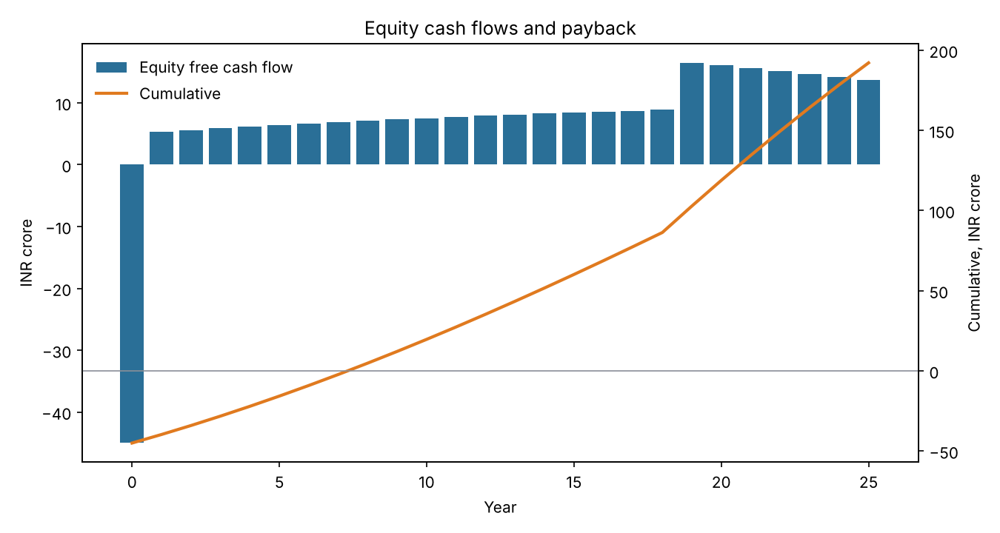
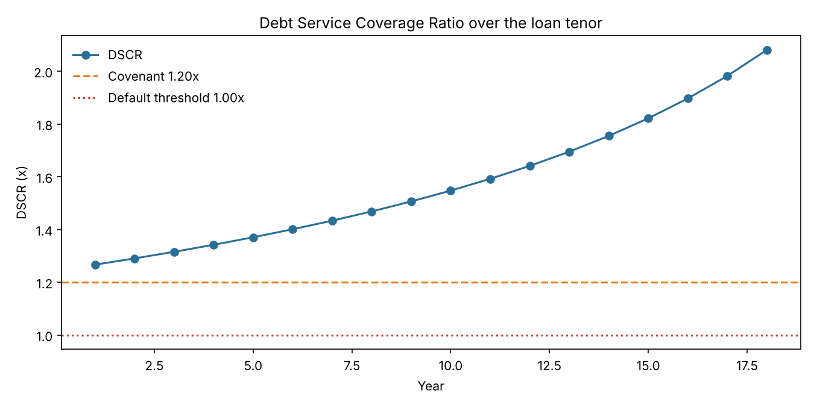
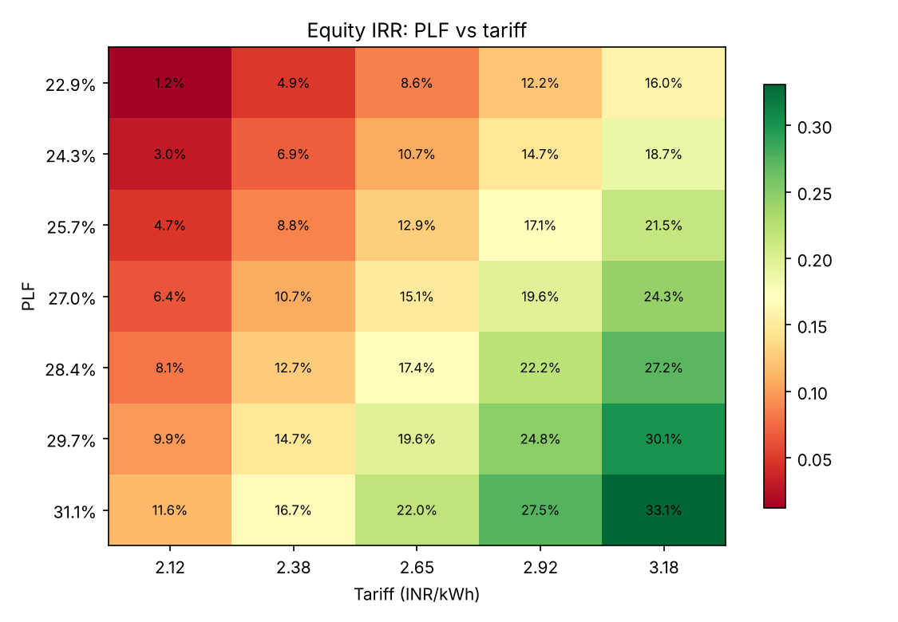
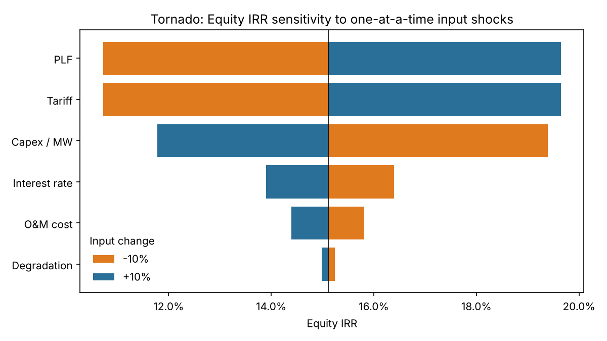
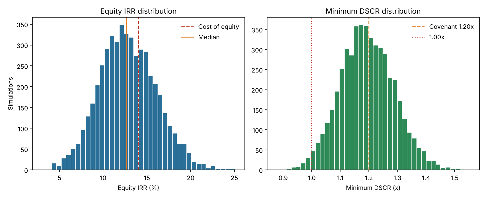

# Renewable Energy Project Appraisal & Financial Feasibility Model

A Python model for appraising utility-scale **solar and wind** projects the way a lender or
appraiser would: generation → revenue → EBITDA → debt schedule → tax → **IRR, NPV, payback, LCOE
and DSCR**, followed by **sensitivity analysis** and a **Monte Carlo risk simulation** on Plant Load
Factor (PLF), tariff, capex and interest rate.

> **Note:** the example inputs in `examples/` are *illustrative* assumptions for demonstration,
> not data from any real project or lender. Replace them with project-specific numbers.

## What it does

| Module | Purpose |
|---|---|
| `reappraisal/model.py` | Year-by-year cash flows, debt schedule, tax with loss carry-forward, all return metrics |
| `reappraisal/metrics.py` | NPV, IRR (bisection), simple and discounted payback, written from scratch |
| `reappraisal/scenarios.py` | PLF × tariff grids, tornado analysis, break-even PLF for a target DSCR |
| `reappraisal/montecarlo.py` | Seeded Monte Carlo (5,000 runs) with P10/P50/P90 and risk probabilities |
| `reappraisal/report.py` | 8-sheet Excel workbook export |
| `reappraisal/plots.py` | Cash flow, DSCR, heatmap, tornado and distribution charts |
| `tests/` | 20 unit tests (IRR/NPV correctness, debt fully repaid, tax loss logic, monotonicity, reproducibility) |

## Methodology

All money in **INR crore**, tariff in **INR/kWh**.

- **Generation (MWh)** = `MW × 8760 × PLF × (1 − degradation)^(t−1)`
- **Revenue** = `generation × tariff_t` (tariff optionally escalated)
- **Opex** = O&M (INR lakh/MW, escalated) + insurance (% of project cost)
- **EBITDA** = Revenue − Opex
- **Debt**: `debt_share × project cost`, repaid over `loan_tenor` years by equal principal or annuity; interest on opening balance
- **Tax**: `tax_rate × max(0, EBITDA − depreciation − interest)` with loss carry-forward; straight-line depreciation over project life
- **CFADS** = EBITDA − tax; **DSCR** = CFADS ÷ (interest + principal)
- **Project IRR / NPV**: unlevered post-tax free cash flow, NPV discounted at **WACC**
- **Equity IRR / NPV**: CFADS − debt service, NPV discounted at cost of equity
- **LCOE** = PV(capex + O&M + insurance) ÷ PV(generation), discounted at WACC
- **Break-even PLF**: lowest PLF at which minimum DSCR still meets a target (bisection)

### Monte Carlo design

Each of the 5,000 draws is one "state of the world" held for the whole project life (for example a
resource-assessment error or a capex overrun), not year-by-year noise.

| Variable | Distribution |
|---|---|
| PLF | Normal, mean = base, SD = 6% of mean (solar), clipped to 0.5×–1.5× base |
| Tariff realisation | Triangular, −10% / 0% / +5% |
| Capex | Triangular, −5% / 0% / +15% (skewed to overruns) |
| Interest rate | Triangular, −1.0 / 0 / +2.0 percentage points |

## Quick start

```bash
git clone https://github.com/Prabbyyy/Renewable-project-appraisal.git
cd renewable-project-appraisal
pip install -r requirements.txt

python -m reappraisal --config examples/solar_50mw.json --out outputs/solar
python -m reappraisal --config examples/wind_100mw.json --out outputs/wind
python -m reappraisal --config examples/solar_50mw.json --sims 20000 --seed 7   # override MC settings

python -m pytest -q          # run the tests
```

Python API:

```python
from dataclasses import replace
from reappraisal import ProjectConfig, run_model

cfg = ProjectConfig(capacity_mw=50, plf=0.27, tariff=2.65)
res = run_model(cfg)
print(res.metrics["equity_irr"], res.metrics["min_dscr"])
print(res.cashflow.head())

# what-if: tariff cut by 10%
print(run_model(replace(cfg, tariff=cfg.tariff * 0.9)).metrics["equity_irr"])
```

## Example results: 50 MW solar (illustrative inputs)

Inputs: ₹3.6 cr/MW capex, 27% PLF, 0.5%/yr degradation, ₹2.65/kWh flat tariff, 75% debt at 9.25%
over 18 years (equal principal), 14% cost of equity, 25-year life.

| Metric | Value |
|---|---|
| Project cost | ₹180 cr (debt 135 / equity 45) |
| Project IRR (post-tax) | 10.10% |
| Equity IRR | 15.11% |
| WACC | 8.69% |
| Project NPV @ WACC | ₹19.6 cr |
| Payback (project) | 8.5 years |
| Min / average DSCR | 1.27x / 1.58x |
| LCOE | ₹2.11/kWh |
| Break-even PLF (min DSCR = 1.0x) | 20.9% |
| Break-even PLF (min DSCR = 1.20x covenant) | 25.5% |

**Monte Carlo (5,000 runs):** equity IRR P10 / P50 / P90 = **8.8% / 12.7% / 17.1%**.
Probability that minimum DSCR falls below the 1.20x covenant: **53.7%**; below 1.0x: **1.6%**;
project NPV negative: **34.8%**.

**Reading the result:** the base case looks comfortable (1.27x), but the base case sits only
slightly above the covenant, so about half the simulated worlds breach it. Default (below 1.0x) is
rare, but covenant breach is not. That is the kind of insight a single-point DCF hides.







PLF and tariff show identical tornado swings because revenue is their product; the real-world
difference is that PLF is a resource risk while tariff is largely contracted under a PPA.

## Outputs

Each run writes to `--out`: `appraisal.xlsx` (Assumptions, Summary, Cashflow, Sens_EquityIRR,
Sens_MinDSCR, Tornado, MC_Summary, MC_Samples), `cashflow.csv`, `mc_samples.csv`,
`summary.json`, and the five PNG charts.

## Project structure

```
renewable-project-appraisal/
├── reappraisal/        # package: config, model, metrics, scenarios, montecarlo, report, plots, cli
├── examples/           # solar_50mw.json, wind_100mw.json
├── tests/              # pytest suite
├── docs/               # figures used in this README
├── requirements.txt
└── README.md
```

## Assumptions and limitations

- Annual periods; construction treated as a single year-0 outflow (no IDC or construction-period interest).
- Straight-line depreciation, no salvage value, no MAT/accelerated tax depreciation.
- No working capital, DSRA, grid/curtailment losses, or GST/duties.
- Flat tariff by default (typical of competitively bid PPAs); escalation is supported.
- Debt service starts in year 1 with no moratorium.
- Monte Carlo inputs are independent. Correlations (for example capex and interest rate) are not modelled.
- Equity IRR uses levered post-tax cash flows; project IRR is unlevered.
- Not investment or credit advice.

## Possible extensions

- Sculpted repayment targeting a constant DSCR
- Year-by-year (not constant) PLF variation, P50/P90 energy-yield cases
- Construction-period IDC and a moratorium
- Merchant-tariff scenarios and curtailment
- Streamlit dashboard on top of `reappraisal.evaluate`

## License

MIT
